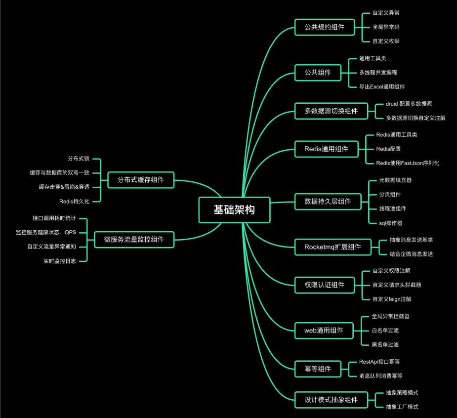
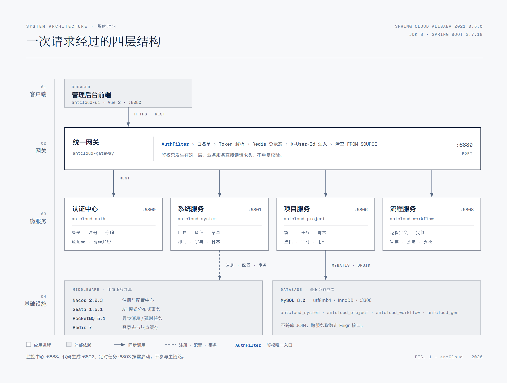
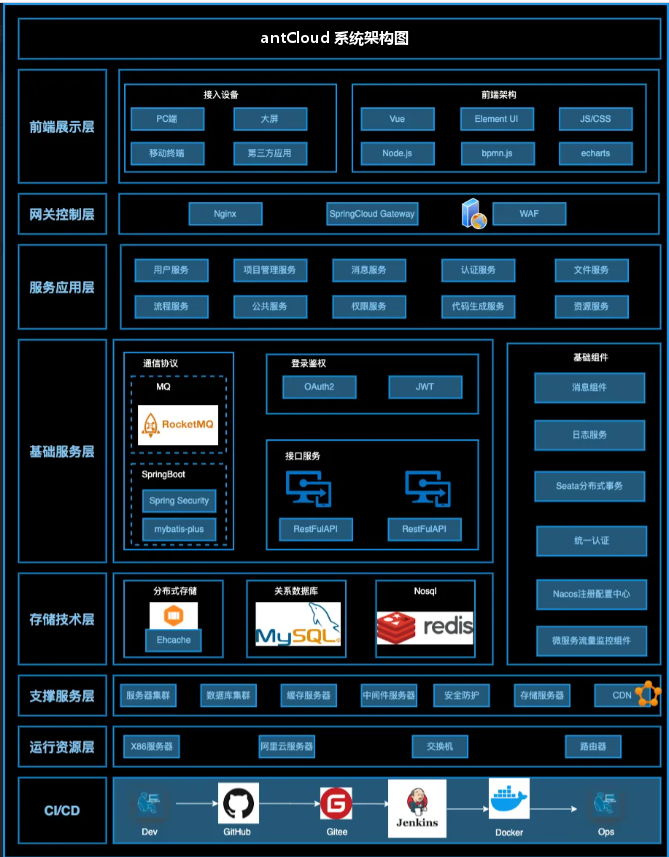
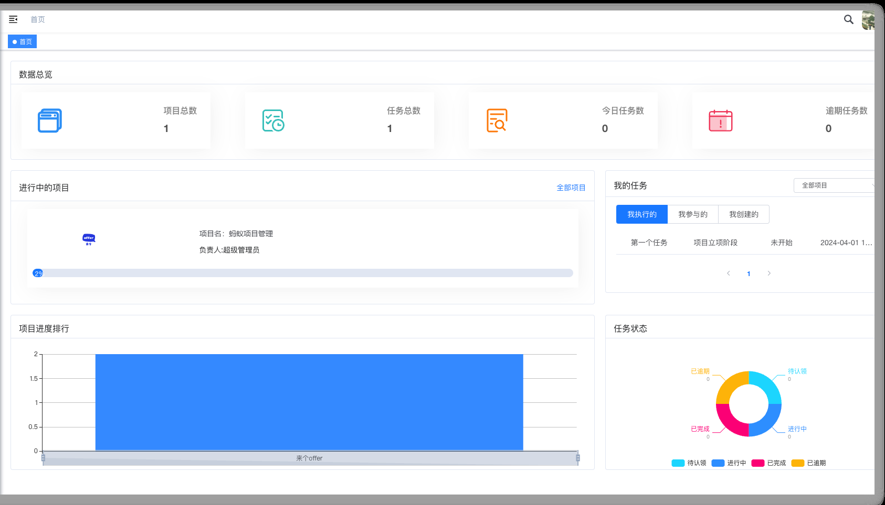
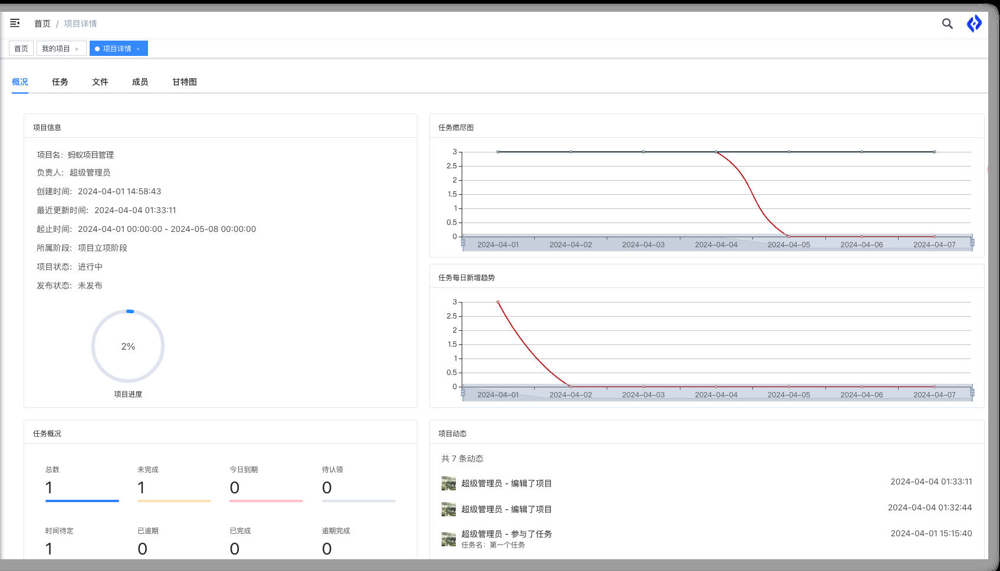
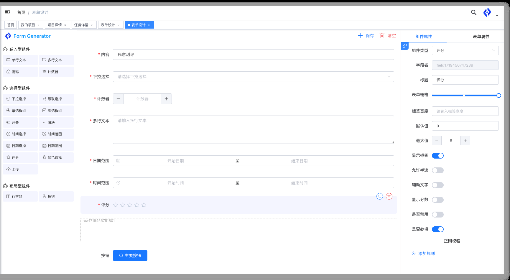
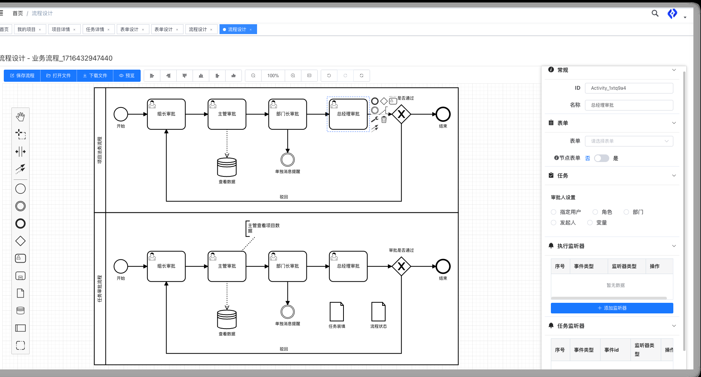

<p align="center"></p>
<h3 align="center">蚂蚁项目管理 · AntCloud</h3>
<p align="center">基于 Spring Cloud Alibaba 的微服务项目管理系统</p>

<p align="center">
  <a href="https://opensource.org/license/MIT"></a>
  <a href="https://github.com/beg222/antCloud"></a>
  <a href="https://github.com/beg222/antCloud"></a>
  
  
</p>

<hr/>

蚂蚁项目管理是一套面向研发团队的**项目管理 + 审批流**平台。它把「项目、任务、成员、文件」的项目域和「流程定义、审批、待办」的工作流域放在同一套账号与权限体系下，解决的是团队里最常见的两个问题：事情有没有人跟进、流程卡在谁那里。

项目采用微服务架构，按业务边界拆成网关、认证、系统、项目、流程、代码生成、定时任务、监控八个可独立部署的服务，服务之间通过 OpenFeign 声明式调用，配置与注册统一交给 Nacos，跨服务写操作由 Seata 保证一致性。

## 目录

- [一、项目亮点](#一项目亮点)
- [二、项目详情](#二项目详情)
  - [2.1 系统架构](#21-系统架构)
  - [2.2 技术选型](#22-技术选型)
  - [2.3 功能模块](#23-功能模块)
  - [2.4 界面预览](#24-界面预览)
  - [2.5 代码结构](#25-代码结构)
  - [2.6 一段真实代码](#26-一段真实代码)
- [三、快速开始](#三快速开始)
- [四、技术栈](#四技术栈)
- [五、内置功能](#五内置功能)
- [六、开源协议](#六开源协议)

## 一、项目亮点

- **微服务架构，不是"伪微服务"**：网关、认证、系统、项目、流程各自独立部署、独立数据库，服务间只通过 Feign 接口通信，没有共享表、没有跨库 JOIN。
- **企业级工作流**：集成 Flowable，支持自定义表单、流程设计器（BPMN）、会签、驳回、加签、抄送、待办与已办，流程节点可绑定项目审批场景。
- **项目全生命周期**：从立项、阶段划分、任务拆解、工时、燃尽图到归档回收站，覆盖一个项目从 0 到结项的完整过程。
- **分布式能力齐全**：Nacos 注册配置、Sentinel 限流熔断、Seata 分布式事务、RocketMQ 异步消息、Redis 缓存与登录态，都是真实接入而非"预留"。
- **代码生成器**：连表查询、字典、权限注解、前后端 CRUD 一次生成，新增一张业务表到页面可用只需要几分钟。
- **统一权限体系**：网关统一鉴权，服务内 `@RequiresPermissions` 细粒度控制，菜单即权限，前后端权限标识一致。

## 二、项目详情

### 2.1 系统架构

在antCloud中，系统架构图展示了整个系统的架构设计。整体项目包括了系统、认证、项目、代码生成、流程及网关服务。


一次请求的完整路径：

1. 浏览器加载 `antcloud-ui`（Vue 2 + Element UI），所有接口统一走 `/dev-api`（生产为 `/prod-api`）代理到网关；
2. `antcloud-gateway`（:6880）做统一鉴权：校验 JWT 有效性与 Redis 中的登录态，把用户信息写入请求头后转发；
3. 网关按路由把请求分发到 `antcloud-auth`（:6800）、`antcloud-system`（:6801）、`antcloud-project`（:6806）、`antcloud-workflow`（:6808）；
4. 各服务从 Nacos 拉取自己的 `antcloud-xxx-dev.yml`，通过 MyBatis + Druid 访问各自的库；
5. 跨服务调用走 OpenFeign（接口定义集中在 `antcloud-api`），需要保证一致性的写操作由 Seata AT 模式接管，异步通知走 RocketMQ。

> 代码生成（:6802）、定时任务（:6803）、监控中心（:6888）按需启动，不影响主链路。


### 2.2 技术选型



| 层 | 选择 | 为什么 |
| --- | --- | --- |
| 接入层 | Vue 2 + Element UI + webpack 4 | 后台管理场景组件最全，权限指令、字典、表格开箱即用 |
| 网关层 | Spring Cloud Gateway + Sentinel | 响应式网关性能好，鉴权/限流都在这一层收口，服务内部不必重复实现 |
| 应用层 | Spring Boot 2.7 + Spring Cloud 2021 + OpenFeign | 企业主流组合，Feign 让远程调用看起来像本地方法，接口契约集中在 `antcloud-api` |
| 数据层 | MySQL 8 + MyBatis + Druid | 业务表关系明确，用原生 SQL 更好控制执行计划；Druid 提供连接池监控与慢 SQL 记录 |
| 中间件 | Nacos + Seata + RocketMQ + Redis | 注册配置、分布式事务、异步解耦、缓存与登录态，四件事各用一件工具 |
| 运行环境 | Docker + JDK 1.8+ | 交付镜像化，环境一致；JDK 8 兼容性最好，也兼容更高版本运行 |

### 2.3 功能模块

| 模块 | 服务 | 端口 | 负责的事 |
| --- | --- | --- | --- |
| 认证中心 | `antcloud-auth` | 6800 | 登录、令牌签发与刷新、退出 |
| 系统服务 | `antcloud-system` | 6801 | 用户、角色、菜单、部门、岗位、字典、参数、日志 |
| 项目服务 | `antcloud-project` | 6806 | 项目、阶段、任务、成员、文件、工时、燃尽图 |
| 流程服务 | `antcloud-workflow` | 6808 | 流程定义、表单、发起、审批、待办已办、抄送 |
| 代码生成 | `antcloud-gen` | 6802 | 读表结构生成前后端 CRUD 代码 |
| 定时任务 | `antcloud-job` | 6803 | Quartz 任务管理与执行日志 |
| 监控中心 | `antcloud-monitor` | 6888 | Spring Boot Admin，服务状态、指标、日志 |
| 前端 | `antcloud-ui` | 8080 | 管理后台 |

### 2.4 界面预览

**工作台**：项目、任务、逾期任务的总览，以及进行中项目和任务状态分布。



**项目详情**：项目信息、进度、任务燃尽图、任务概况与项目动态。



**表单设计器**：拖拽生成表单，支持输入、选择、日期、评分等组件与校验规则。



**流程设计器**：基于 bpmn-js 的 BPMN 设计器，支持审批人设置、表单绑定、执行监听器。



### 2.5 代码结构

```
antCloud
├── antcloud-gateway          // 网关服务 [6880]
├── antcloud-auth             // 认证中心 [6800]
├── antcloud-api              // 服务间调用接口
│   ├── antcloud-api-system                     // 系统服务接口
│   └── antcloud-api-workflow                   // 流程服务接口
├── antcloud-base             // 公共能力
│   ├── antcloud-base-core                      // 核心工具、统一返回体
│   ├── antcloud-base-datasource                // 数据源与 MyBatis 配置
│   ├── antcloud-base-security                  // 鉴权、权限注解、Feign 客户端
│   ├── antcloud-base-seata                     // 分布式事务
│   ├── antcloud-base-swagger                   // 接口文档
│   ├── antcloud-base-notice                    // 消息通知
│   └── antcloud-base-sensitive                 // 脱敏
├── antcloud-modules          // 业务服务
│   ├── antcloud-system                         // 系统服务 [6801]
│   ├── antcloud-gen                            // 代码生成 [6802]
│   ├── antcloud-job                            // 定时任务 [6803]
│   ├── antcloud-project                        // 项目服务 [6806]
│   └── antcloud-workflow                       // 流程服务 [6808]
├── antcloud-monitor          // 监控中心 [6888]
├── antcloud-ui               // 前端工程 [8080]
├── docker                    // compose 文件与中间件配置
├── sql                       // 各库初始化脚本与 Nacos 配置种子
└── pom.xml                   // 统一依赖管理
```

### 2.6 一段真实代码

网关的鉴权过滤器，所有请求都会先经过这里。它做四件事：白名单放行、令牌校验、登录态校验、把用户信息透传给下游服务。

```java
@Override
public Mono<Void> filter(ServerWebExchange exchange, GatewayFilterChain chain) {
    ServerHttpRequest request = exchange.getRequest();
    ServerHttpRequest.Builder mutate = request.mutate();

    String url = request.getURI().getPath();
    // 跳过不需要验证的路径
    if (StringUtils.matches(url, ignoreWhite.getWhites())) {
        return chain.filter(exchange);
    }
    String token = getToken(request);
    if (StringUtils.isEmpty(token)) {
        return unauthorizedResponse(exchange, "令牌不能为空");
    }
    Claims claims = JwtUtils.parseToken(token);
    if (claims == null) {
        return unauthorizedResponse(exchange, "令牌已过期或验证不正确！");
    }
    // 令牌有效还不够，还要确认 Redis 中的登录态没被踢下线
    String userkey = JwtUtils.getUserKey(claims);
    if (!redisService.hasKey(getTokenKey(userkey))) {
        return unauthorizedResponse(exchange, "登录状态已过期");
    }

    // 设置用户信息到请求，下游服务不再解析令牌
    addHeader(mutate, SecurityConstants.USER_KEY, userkey);
    addHeader(mutate, SecurityConstants.DETAILS_USER_ID, JwtUtils.getUserId(claims));
    addHeader(mutate, SecurityConstants.DETAILS_USERNAME, JwtUtils.getUserName(claims));
    // 清除内部请求标识，防止外部伪造内部调用
    removeHeader(mutate, SecurityConstants.FROM_SOURCE);

    return chain.filter(exchange.mutate().request(mutate.build()).build());
}
```

## 三、快速开始

### 3.1 环境要求

| 组件 | 版本 | 是否必须 | 说明 |
| --- | --- | --- | --- |
| JDK | 1.8+ | 是 | 本地在 JDK 21 上编译运行验证通过 |
| Maven | 3.6+ | 是 | 建议配置国内镜像 |
| MySQL | 8.0 | 是 | 每个服务一个库 |
| Redis | 6.0+ | 是 | 缓存、登录态、验证码 |
| Nacos | 2.2.3 | 是 | 注册中心 + 配置中心 |
| Seata | 1.6.1 | 否 | 分布式事务，注册到 Nacos 的 `SEATA_GROUP` |
| RocketMQ | 5.x | 否 | 异步消息 |
| Node.js | 16+ | 是 | 前端构建，Node 17+ 需 `--openssl-legacy-provider` |

### 3.2 初始化数据库

按顺序执行 `sql/` 下的脚本，每个服务对应一个库：

```bash
mysql -uroot -p < sql/antcloud-system.sql
mysql -uroot -p < sql/antcloud-project.sql
mysql -uroot -p < sql/antcloud-workflow.sql
mysql -uroot -p < sql/antcloud-gen.sql
mysql -uroot -p < sql/antcloud_seata.sql     # 使用 Seata 时需要
mysql -uroot -p < sql/antcloud_nacos.sql     # Nacos 配置中心需要
```

### 3.3 启动中间件

```bash
# Nacos（standalone 模式）
sh startup.sh -m standalone        # Windows 双击 startup.cmd

# Redis
redis-server

# Seata（可选，file 模式即可本地调试）
seata-server.sh -p 8091 -m file

# RocketMQ（可选）
sh bin/mqnamesrv & sh bin/mqbroker -n localhost:9876
```

Nacos 启动后访问 `http://localhost:8848/nacos`（默认 nacos/nacos），确认 `antcloud-system-dev.yml`、`antcloud-project-dev.yml`、`antcloud-workflow-dev.yml` 里的数据库、Redis 地址与本机一致。

### 3.4 启动后端

按依赖顺序启动，或在 IDEA 中依次运行各自的 `*Application`：

| 顺序 | 服务 | 启动类 | 端口 |
| --- | --- | --- | --- |
| 1 | 认证中心 | `AntCloudAuthApplication` | 6800 |
| 2 | 系统服务 | `AntCloudSystemApplication` | 6801 |
| 3 | 项目服务 | `AntCloudProjectApplication` | 6806 |
| 4 | 流程服务 | `AntCloudWorkflowApplication` | 6808 |
| 5 | 网关 | `AntCloudGatewayApplication` | 6880 |

产物构建：

```bash
mvn clean install -DskipTests
```

### 3.5 启动前端

```bash
cd antcloud-ui
npm install
npm run dev
```

浏览器访问 `http://localhost:8080`，开发代理 `/dev-api` 指向 `http://127.0.0.1:6880`。

### 3.6 默认账号

| 账号 | 密码 | 说明 |
| --- | --- | --- |
| `admin` | `123456` | 超级管理员 |

> 首次部署后请立即修改默认密码，并在 Nacos 中关闭验证码开关以外的调试项。

## 四、技术栈

| 分类 | 技术 | 版本 |
| --- | --- | --- |
| 基础框架 | Spring Boot | 2.7.18 |
| 微服务 | Spring Cloud / Spring Cloud Alibaba | 2021.0.8 / 2021.0.5.0 |
| 网关 | Spring Cloud Gateway | 随 Spring Cloud |
| 服务调用 | OpenFeign + LoadBalancer | 随 Spring Cloud |
| 注册配置 | Nacos | 2.2.3 |
| 限流熔断 | Sentinel | 随 SCA |
| 分布式事务 | Seata | 1.6.1 |
| 消息队列 | RocketMQ | 5.1.0 |
| 缓存 | Redis + Redisson | 6.x |
| 数据库 | MySQL | 8.0 |
| 持久层 | MyBatis + Druid | 2.2.2 / 1.2.20 |
| 工作流 | Flowable | 随 antcloud-workflow |
| 接口文档 | Knife4j + Swagger | 3.0.3 |
| 工具库 | Hutool | 5.8.11 |
| 前端 | Vue 2 + Element UI + webpack 4 | — |
| 构建 | Maven | 3.9 |

## 五、内置功能

1. **用户管理**：用户是系统操作者，完成账号、部门、岗位、角色的配置。
2. **部门管理**：树形组织结构，支持数据权限。
3. **岗位管理**：维护用户职务，可与用户绑定。
4. **菜单管理**：配置系统菜单、操作权限、按钮权限标识。
5. **角色管理**：角色菜单权限分配，按机构划分数据范围。
6. **字典管理**：维护系统中相对固定的枚举数据。
7. **参数管理**：动态配置系统常用参数。
8. **通知公告**：系统通知的发布与维护。
9. **操作日志**：正常操作与异常信息的记录和查询。
10. **登录日志**：登录记录查询，含异常登录。
11. **在线用户**：当前活跃用户状态监控，可强制下线。
12. **定时任务**：在线增删改任务，记录执行结果。
13. **代码生成**：读取表结构生成 Java、XML、Vue、SQL 代码，支持 CRUD 下载。
14. **系统接口**：根据业务代码自动生成 API 文档。
15. **服务监控**：CPU、内存、磁盘、JVM 堆栈等信息。
16. **缓存监控**：Redis 信息查询与命令统计。
17. **连接池监视**：Druid 数据源状态与慢 SQL 分析。
18. **项目管理**：项目、阶段、任务、成员、文件、工时与燃尽图。
19. **流程管理**：流程分类、表单设计、流程设计、部署、发起、审批与待办。

## 六、开源协议

[MIT License](LICENSE) © 2026 beg
